<div align="center">
  

  <p>
    <a href="https://linkedin.com/in/8syncdev"></a>
    <a href="https://www.youtube.com/@Dev8Sync"></a>
    <a href="https://www.tiktok.com/@8syncdev"></a>
    <a href="https://huggingface.co/alexdev159"></a>
    <a href="https://orcid.org/0009-0005-9352-9353"></a>
    <a href="https://8syncdev.com"></a>
  </p>
</div>

```ts
const alex = {
  role:     ["AI Team Lead @ CloudGO", "Founder @ 8 Sync"],
  building: "autonomous AI agent systems for CRM, video & marketing",
  research: "2 peer-reviewed papers, Journal of Technical Education Science",
  teaching: "programming & AI to 1,000+ students since 2021",
  motto:    "We teach you to learn, not to copy.",
  contact:  "atus@8syncdev.com",
};
```

## 🤖 Agent systems I build

| | System | What it does |
| :-: | --- | --- |
| 🧲 | **AcoLeads** | AI-agent CRM: ReAct agents with GraphRAG retrieval (Go, Eino, pgvector) that qualify and nurture leads, with anti-hallucination guardrails |
| 🎬 | **Video & marketing pipeline** | Agents research, script, render and visually check course and social videos; publishing waits for human approval |
| 🛤️ | **[8sync](https://github.com/8-Sync-Dev/8sync)** | One Rust binary that runs Claude Code with guard, verify and stop gates, from small edits to multi-task autopilot |
| 🧠 | **[mind0](https://mind0.8syncdev.com)** | Shared memory for agent fleets: Retain → Extract → Recall → Reflect over an entity graph, with fact supersession and per-answer cost telemetry |
| ⚡ | **[ZUS](https://zus.8syncdev.com)** | Local-first AI IDE (Tauri 2 + Rust, 22.3 MB installer) with a plan → act → verify coding agent |

## 🌐 Live products

<p>
  <a href="https://8syncdev.com"></a>
  <a href="https://coding.8syncdev.com"></a>
  <a href="https://course.8syncdev.com"></a>
  <a href="https://news.8syncdev.com"></a>
  <a href="https://zus.8syncdev.com"></a>
  <a href="https://tia.8syncdev.com"></a>
</p>

## 📦 Open source

| Repo | | |
| --- | --- | --- |
| [**8-Sync-Dev/8sync**](https://github.com/8-Sync-Dev/8sync) | Claude Code on autopilot, with rails. Windows · macOS · Linux |  |
| [**8-Sync-Dev/flash-term**](https://github.com/8-Sync-Dev/flash-term) | A Windows 11 terminal setup: WezTerm, CLI tools, dev runtimes, local GGUF server |  |
| [**8-Sync-Dev/claude-desktop-linux**](https://github.com/8-Sync-Dev/claude-desktop-linux) | One-command installer for Claude Desktop on Linux |  |
| [**ollama-docker-web-application**](https://github.com/8syncdev/ollama-docker-web-application) | AI agent web app on local LLMs (Ollama + Docker) |  |
| [**edu-mobile-app-flet**](https://github.com/8syncdev/edu-mobile-app-flet) | Programming-courses mobile app in Python + Flet |  |

## 📄 Research

- **Sentiment Prediction Based on Deep Learning for Intelligent E-Learning Systems** — JTE, 2025 (lead author) · [doi:10.54644/jte.2025.1661](https://doi.org/10.54644/jte.2025.1661)
- **Development of Code Evaluation System based on Abstract Syntax Tree** — JTE, 2024 · [doi:10.54644/jte.2024.1514](https://doi.org/10.54644/jte.2024.1514)

## 🧰 Stack

<p>
  
</p>

**AI:** AI agents · LLM engineering · RAG / GraphRAG · agent memory · LLM evaluation · MCP

## 🐍 Contributions

<picture>
  <source media="(prefers-color-scheme: dark)" srcset="https://raw.githubusercontent.com/8syncdev/8syncdev/output/snake-dark.svg" />
  
</picture>

<div align="center"><sub>Building in public from Ho Chi Minh City · member of NVIDIA Inception with <a href="https://github.com/8-Sync-Dev">8 Sync</a></sub></div>
